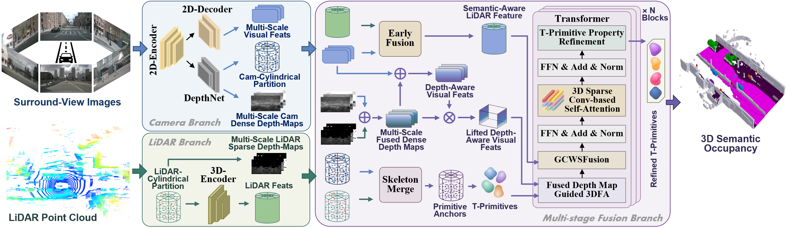

# TFusionOcc
TFusionOcc: T-Primitive Based Object-Centric Multi-Sensor Fusion Framework for 3D Occupancy Prediction [[Paper](https://ieeexplore.ieee.org/document/11770071)]
## Abstract
The prediction of 3D semantic occupancy enables autonomous vehicles (AVs) to perceive the fine-grained geometric and semantic scene structure for safe navigation and decision-making. Existing methods mainly rely on either voxel-based representations, which incur redundant computation over empty regions, or object-centric Gaussian primitives, whose ellipsoidal per-primitive geometry can limit representation efficiency for complex, non-convex, and asymmetric structures under a fixed primitive and computational budget.
In this paper, we present TFusionOcc, a T-primitive-based object-centric multi-sensor fusion framework for 3D semantic occupancy prediction. Specifically, we introduce a family of Student’s t-distribution-based T-primitives, including the plain T-primitive, T-Superquadric, and deformable T-Superquadric with inverse warping, where the deformable T-Superquadric serves as the key geometry-enhancing primitive. We further develop a unified probabilistic formulation based on the Student’s t-distribution and the T-mixture model (TMM) to jointly model occupancy and semantics, and design a tightly coupled multi-stage fusion architecture to integrate camera and LiDAR cues effectively. Extensive experiments on nuScenes demonstrate competitive performance against recent state-of-the-art methods and strong performance among object-centric multi-sensor approaches, while additional evaluations on nuScenes-C show robust performance across most corruption scenarios. Further evaluation on the separate SemanticKITTI benchmark demonstrates cross-dataset applicability.
## Overall Architecture
<p align='center'>

</p>

## Model Zoo
| T-Primitive Types | Dataset | Input Modality | Num.T-Primitives | IoU | mIoU | Model Weights |
| :---: | :---: | :---: | :---: | :---: | :---: | :---: | 
| T-P | SurroundOcc-Nuscenes | C + L | 25600 | 45.49 | 30.04 | [ckpt](https://drive.google.com/file/d/1Qx57ji2DNxsImUD5Xnad3Zb1qN18zfwP/view?usp=sharing)
| T-SQ | SurroundOcc-Nuscenes | C + L | 25600 | 46.37 | 31.03 | [ckpt](https://drive.google.com/file/d/1rQ-zxQ8Rz67vqTVeCQuoBFVn4CHqgbMp/view?usp=sharing)
| T-SQ-IW | SurroundOcc-Nuscenes | C + L | 25600 | 47.26 | 31.51 | [ckpt](https://drive.google.com/file/d/1kLC75N3skRJUfCSEQF09UQlB_QxTocgn/view?usp=sharing)

| T-Primitive Types | Dataset | Input Modality | Num.T-Primitives | mIoU | Model Weights |
| :---: | :---: | :---: | :---: | :---: | :---: |
| T-P | SemanticKITTI | C + L | 25600 | 22.02 | [ckpt](https://drive.google.com/file/d/1FCFpmGxAmrVWuqn2q7CrYjngHSPJkad3/view?usp=sharing)
| T-SQ | SemanticKITTI | C + L | 25600 | 23.50 | [ckpt](https://drive.google.com/file/d/1lgfrVDhasyEeU6qNohmNYPCdmC7S5QRj/view?usp=sharing)
| T-SQ-IW | SemanticKITTI | C + L | 25600 | 24.51 | [ckpt](https://drive.google.com/file/d/12ZaGan5Zp3AkKg_-89XnDb44YRYVUsmt/view?usp=sharing)

## Getting Started
- [Installation](docs/install.md)
- [Dataset](docs/dataset.md)
- [Run and Eval](docs/getting_started.md)
## Acknowledgement
Our work is inspired by these excellent open-sourced repos, many thanks to these excellent projects:
- [SurroundOcc](https://github.com/weiyithu/SurroundOcc)
- [Occ3D](https://github.com/Tsinghua-MARS-Lab/Occ3D)
- [GaussianFormer](https://github.com/huang-yh/GaussianFormer)
- [QuadricFormer](https://github.com/zuosc19/QuadricFormer)
## Bibtex
If this work is helpful for your research, please consider citing the following BibTeX entry.
```
@ARTICLE{11770071,
  author={Ming, Zhenxing and Huang, Yaoqi and Berrio, Julie Stephany and Shan, Mao and Worrall, Stewart},
  journal={IEEE Transactions on Circuits and Systems for Video Technology}, 
  title={TFusionOcc: T-Primitive Based Object-Centric Multi-Sensor Fusion Framework for 3D Occupancy Prediction}, 
  year={2026},
  volume={},
  number={},
  pages={1-1},
  keywords={Laser radar;Modeling;Cameras;Visualization;Distance measurement;Modules (abstract algebra);Image sensors;Geometry;Renewable Portfolio Standard;Conferences;Autonomous driving;3D semantic occupancy prediction;Multi-sensor fusion;Environment perception},
  doi={10.1109/TCSVT.2026.3749226}}

